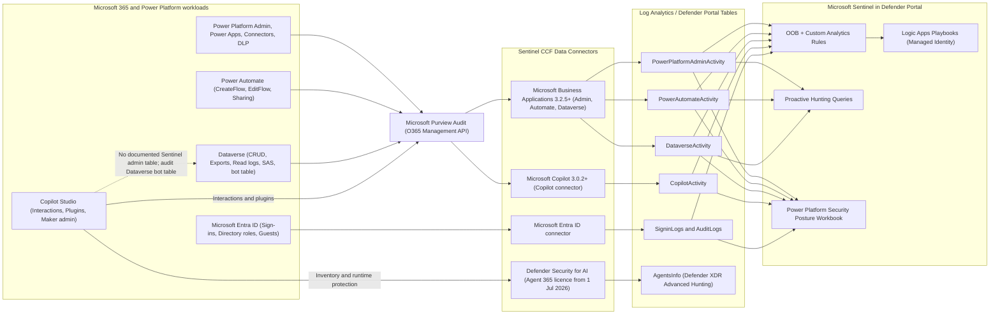
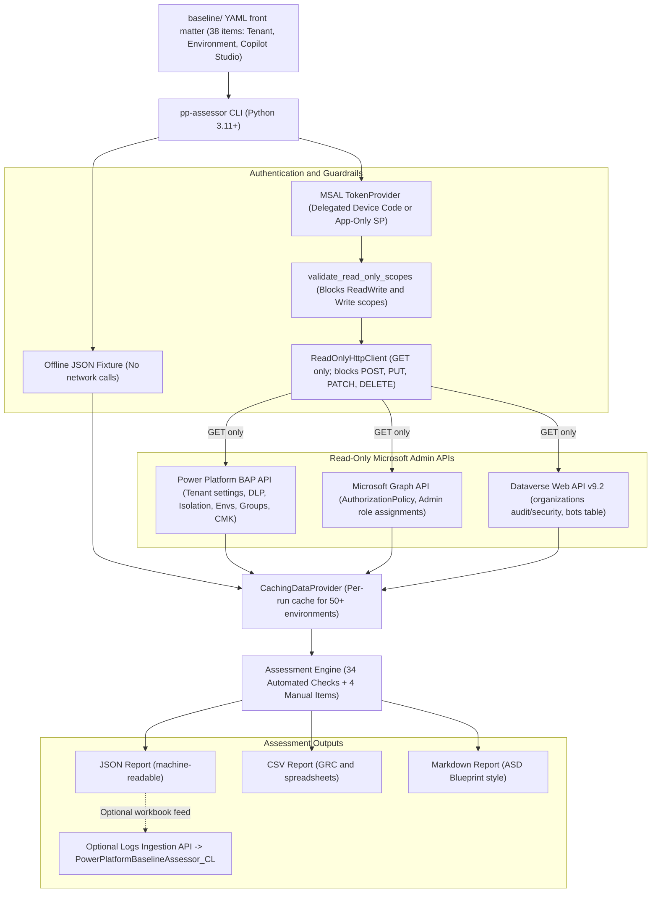
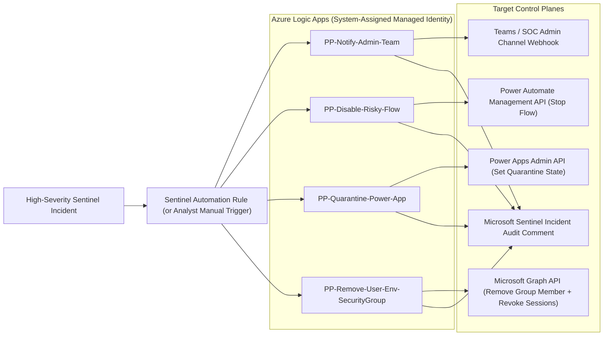

# Architecture diagrams

This document illustrates how security telemetry flows from Microsoft Power Platform, Dataverse and Copilot Studio into Microsoft Sentinel (hosted in the Microsoft Defender portal), how the read-only assessor evaluates baseline settings, and how response playbooks operate with Managed Identity.

All log table names, connectors and gaps reflect the verification in [docs/research/verification.md](research/verification.md).

## 1. Security telemetry flow into Microsoft Sentinel

Key architectural notes:

- Do not ingest legacy tables (`PowerAppsActivity`, `PowerPlatformConnectorActivity`, `PowerPlatformDlpActivity`, `Dynamics365Activity`, `LLMActivity`, `AIAgentsInfo`).
- Microsoft Sentinel retires in the Azure portal after **31 March 2027** ([Microsoft Sentinel in the Microsoft Defender portal](https://learn.microsoft.com/en-us/azure/sentinel/microsoft-sentinel-defender-portal)).
- Because Microsoft does not document a Sentinel table for Purview Copilot Studio maker/admin events (`BotCreate`, `BotUpdateOperation-*`), auditing the Dataverse `bot` table (`DataverseActivity`) and blocking unauthenticated chat via DLP (`PP-CS-002`) close the gap.

## 2. Read-only baseline assessor data flow

## 3. Incident response playbook flow

## References

- [Microsoft Sentinel solution for Microsoft Business Applications | Microsoft Learn](https://learn.microsoft.com/en-us/azure/sentinel/business-applications/solution-overview)
- [Microsoft Sentinel in the Microsoft Defender portal | Microsoft Learn](https://learn.microsoft.com/en-us/azure/sentinel/microsoft-sentinel-defender-portal)
- [Microsoft Power Platform API reference | Microsoft Learn](https://learn.microsoft.com/en-us/rest/api/power-platform/)
- [Automate threat response with playbooks in Microsoft Sentinel | Microsoft Learn](https://learn.microsoft.com/en-us/azure/sentinel/automation/automate-responses-with-playbooks)
- [ADR 0001: Assessor language and auth](adr/0001-assessor-language-and-auth.md)
