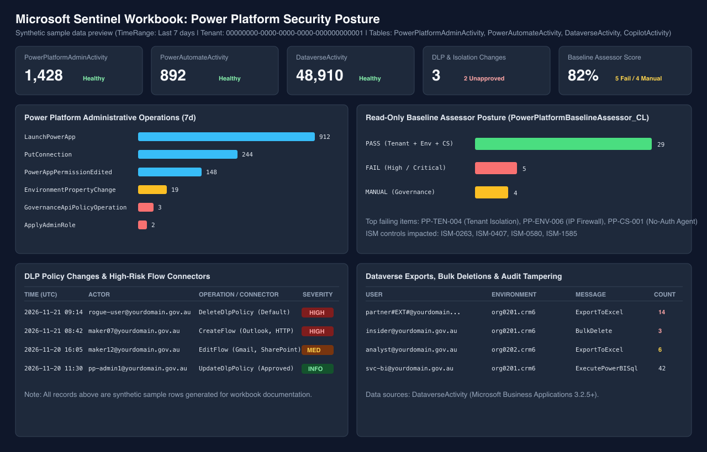

# Power Platform Security Posture Workbook

An Azure Monitor / Microsoft Sentinel workbook ([PowerPlatformSecurityPosture.json](PowerPlatformSecurityPosture.json)) providing a unified view of:

- Ingestion health across `PowerPlatformAdminActivity`, `PowerAutomateActivity`, `DataverseActivity` and `CopilotActivity`
- Power Platform administrative operations and privileged changes
- Data Loss Prevention (DLP) policy creations, updates and deletions
- Risky makers (correlating `SigninLogs` risk with `PowerAutomateActivity`)
- High-risk connector usage across flows
- Dataverse exports, bulk deletions and audit tampering
- Read-only baseline assessor posture results (when ingested into the optional custom table `PowerPlatformBaselineAssessor_CL`)

## Deploy to Azure

> **Portal note**: Microsoft Sentinel transitions exclusively to the [Microsoft Defender portal](https://learn.microsoft.com/en-us/azure/sentinel/microsoft-sentinel-defender-portal) after **31 March 2027**. After deploying the ARM template, open the workbook under **Microsoft Sentinel** > **Threat management** > **Workbooks** in the Defender portal.

## Synthetic data preview

The screenshot below renders the workbook panels populated with synthetic sample data (no live tenant data):

## Optional: ingesting assessor results into `PowerPlatformBaselineAssessor_CL`

To populate the **Baseline assessor results** panel, run the read-only assessor in JSON mode (`pp-assessor assess ... --format json`) and ingest the `findings` array via the [Azure Monitor Logs Ingestion API](https://learn.microsoft.com/en-us/azure/azure-monitor/logs/logs-ingestion-api-overview) into a custom DCR table named `PowerPlatformBaselineAssessor_CL` with the following columns:

| Column | Type | Source field in assessor JSON |
| --- | --- | --- |
| `TimeGenerated` | `datetime` | Report `generated_at` |
| `BaselineId_s` | `string` | `findings[].baseline_id` |
| `TargetName_s` | `string` | `findings[].target_name` |
| `Severity_s` | `string` | `findings[].severity` |
| `Status_s` | `string` | `findings[].status` |
| `Title_s` | `string` | `findings[].title` |
| `IsmControls_s` | `string` | Joined `findings[].ism_controls` |

If `PowerPlatformBaselineAssessor_CL` has not been created in the workspace yet, the workbook query uses `union isfuzzy=true` with an empty `datatable` fallback so the panel renders cleanly without query errors.
